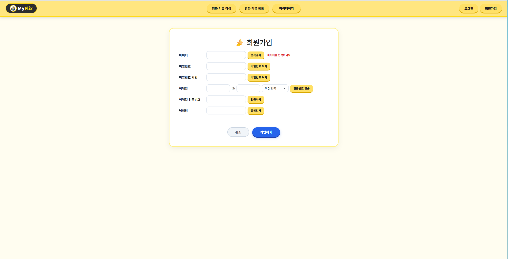
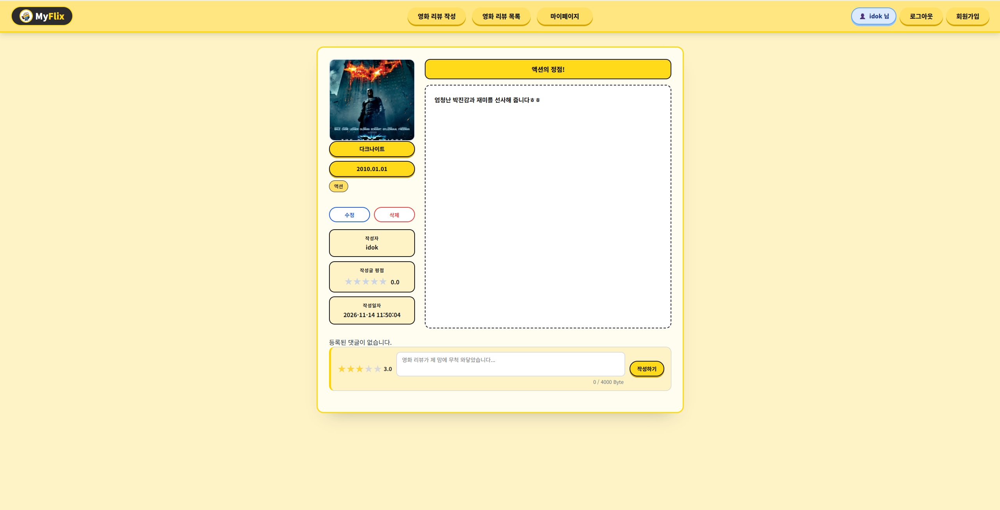
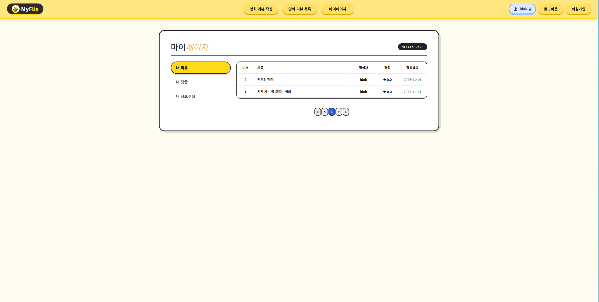
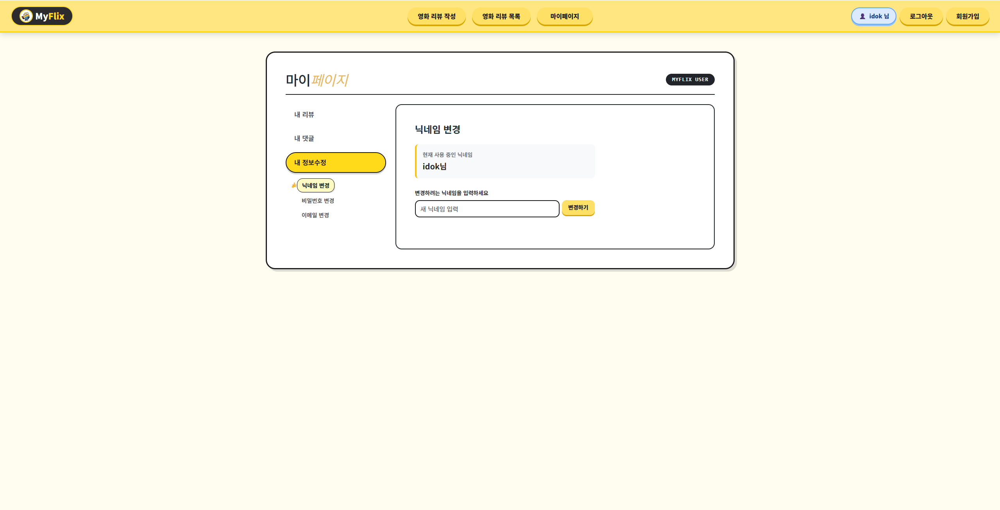

# MyFlix

영화를 주제로 자유롭게 소통하는 영화 리뷰 커뮤니티입니다.

## 1. 프로젝트 소개

- 프로젝트명: MyFlix
- 개발 기간: 2026.08.03 ~ 2026.08.28
- 개발 환경: Java 17, JSP, Servlet, Oracle DB, Tomcat 9

## 2. 주요 기능

- 회원가입 및 로그인
- 영화 리뷰 게시글 작성 및 조회
- 댓글 작성 및 평점 등록
- 이미지 업로드
- 마이페이지 회원 정보 조회 및 수정
- 이메일 인증을 통한 회원 정보 변경
- 데이터베이스 연동

## 3. 담당 역할

### 마이페이지 기능 구현

- 내 리뷰 목록 조회
- 내 댓글 목록 조회
- 회원 닉네임 변경
- 회원 비밀번호 변경
  - 이메일 인증 코드 발송 및 인증 확인
  - 인증 완료 후 비밀번호 변경 처리
- 회원 이메일 변경
  - 변경할 이메일로 인증 코드 발송
  - 이메일 인증 완료 후 정보 수정
- JDBC를 이용한 Oracle DB 데이터 조회 및 수정

## 4. 개발 환경

- Language: Java 17
- Backend: JSP, Servlet, JDBC
- Frontend: HTML, CSS, JavaScript, jQuery, Bootstrap
- Database: Oracle
- Server: Apache Tomcat 9
- IDE: Eclipse

## 5. 실행 화면

### 5-1. 메인 페이지

서비스의 메인 화면으로, 영화 커뮤니티의 주요 콘텐츠를 확인할 수 있습니다.

### 5-2. 로그인 페이지

아이디와 비밀번호를 입력하여 서비스에 로그인할 수 있습니다.

### 5-3. 회원가입 페이지

회원가입에 필요한 정보를 입력하고 이메일 인증을 통해 계정을 생성할 수 있습니다.

### 5-4. 영화 리뷰 작성 페이지

영화 리뷰의 제목과 내용, 이미지를 입력하여 게시글을 작성할 수 있습니다.

### 5-5. 영화 리뷰 목록 페이지

등록된 영화 리뷰 목록을 확인하고 원하는 게시글을 선택할 수 있습니다.

### 5-6. 영화 리뷰 조회 페이지

선택한 영화 리뷰의 상세 내용과 첨부 이미지를 확인하고 댓글을 이용할 수 있습니다.

### 5-7. 마이페이지 - 리뷰 관리

로그인한 회원이 작성한 영화 리뷰 목록을 확인할 수 있습니다.

### 5-8. 마이페이지 - 닉네임 변경

회원 정보를 확인하고 닉네임을 변경할 수 있습니다.

